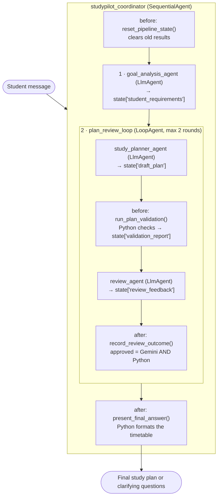
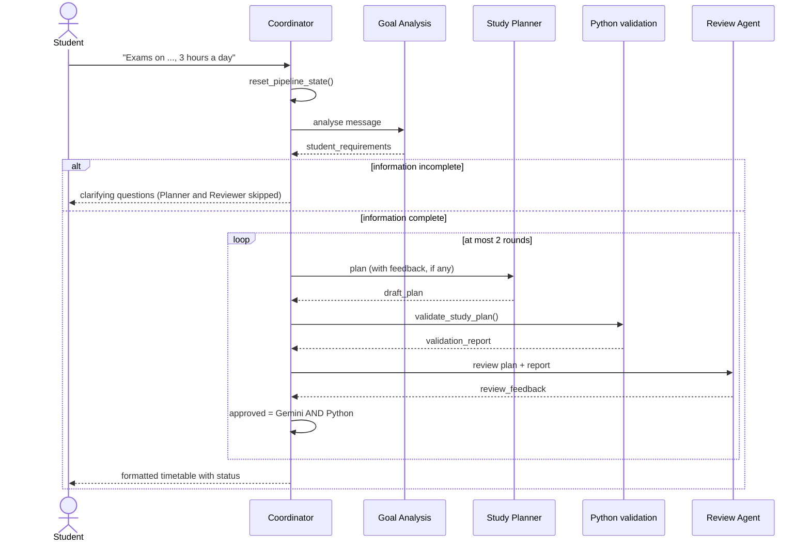

# StudyPilot AI – A Multi-Agent Learning Planner
StudyPilot AI turns a student's free-text request into a **realistic, reviewed study timetable**.
It is built with **Google Agent Development Kit (ADK) 2.13.0** and the **Gemini API**, using three
specialised agents coordinated by a SequentialAgent and a LoopAgent, with **deterministic Python
validation** so the timetable's numbers and dates are always checked by code, not by the LLM.
> Example request: *"I have exams in Maths on 2026-11-06 and Physics on 2026-11-09. I am average in
> Maths and weak in Physics. I can study 3 hours a day."*
> → A day-by-day timetable that never exceeds 3 hours a day, finishes each subject before its exam,
> gives more time to Physics, and ends with revision and mock tests.
---
## Features
- **Three use cases with the same agents:** exam preparation, placement preparation
 (Python, SQL, aptitude, technical and HR interviews), and technical learning roadmaps.
- **Understands free text:** subjects, topics, deadlines (including relative dates such as
 "in 3 weeks"), daily hours and skill levels.
- **Never guesses missing information:** if hours or deadlines are missing, it asks the student.
- **Python-checked timetable:** daily hour limits, deadlines, missing subjects, duplicate or invalid
 dates and impossible deadlines are checked by deterministic Python code.
- **Review and revision loop:** a Review Agent approves the plan or sends specific feedback; the
 Planner gets at most one more attempt.
- **Quota-aware:** skips unnecessary Gemini calls (about 3 calls per request instead of 5) and
 retries temporary errors.
- **Tested:** 32 offline pytest tests (no API calls) plus 2 optional live tests.
---
## Architecture

| Component | Type | Role |
|---|---|---|
| `studypilot_coordinator` | `SequentialAgent` | Runs goal analysis once, then the plan–review loop, in a fixed order |
| `goal_analysis_agent` | `LlmAgent` + `output_schema` | Extracts structured requirements; lists missing information |
| `plan_review_loop` | `LoopAgent` (`max_iterations=2`) | Lets the Planner and Reviewer take turns |
| `study_planner_agent` | `LlmAgent` + `output_schema` | Builds the day-by-day timetable; reads `{review_feedback?}` to fix problems |
| `review_agent` | `LlmAgent` + `output_schema` | Reads the Python validation report and judges quality |
| Callbacks (`callbacks.py`) | Python | Reset, skip, approval decision and final formatting |
| `tools/validation.py` | Python | Deterministic checks (no AI) |
| `tools/formatting.py` | Python | Builds the student-facing answer (no AI) |
### How the agents share data
Agents never call each other. They share **session state** (a dictionary that lives for one
conversation):
1. Each `LlmAgent` has an **`output_key`**. ADK saves the agent's answer into state under that key.
2. The next agent's instruction contains a placeholder such as **`{student_requirements}`**, which ADK
  replaces with the value from state before calling Gemini. `{review_feedback?}` (with `?`) is
  optional, so the first planning round works before any feedback exists.
3. **Callbacks** read and write state at fixed moments (before or after an agent runs).
| State key | Written by | Read by |
|---|---|---|
| `student_requirements` | Goal Analysis Agent | Planner, Reviewer, callbacks, formatter |
| `draft_plan` | Study Planner Agent | `run_plan_validation`, Reviewer, `record_review_outcome` |
| `validation_report` | `run_plan_validation` (Python) | Reviewer |
| `review_feedback` | Review Agent | Planner (next round), `record_review_outcome` |
| `plan_approved`, `final_plan`, `review_rounds` | `record_review_outcome` (Python) | skip callbacks, formatter |
### Why Python decides approval
The LLM could approve a plan by mistake, so after each review a Python callback decides:
**approved = Review Agent says approved AND the Python validation report is valid.**
Once approved, the plan is frozen in `final_plan`, and further rounds are skipped without calling Gemini.
---
## Workflow

---
## Project structure
```
studypilot/
├── studypilot_ai/                 # ADK agent package (created with `adk create`)
│   ├── __init__.py
│   ├── agent.py                   # root_agent: SequentialAgent + LoopAgent
│   ├── callbacks.py               # reset, skip, approval decision, final answer
│   ├── config.py                  # model name, API key check, retry settings
│   ├── schemas.py                 # Pydantic models: StudentRequirements, StudyPlan, ReviewResult
│   ├── .env                       # your secrets (never committed)
│   ├── .env.example               # placeholder template (safe to commit)
│   ├── sub_agents/
│   │   ├── goal_analysis_agent.py
│   │   ├── study_planner_agent.py
│   │   └── review_agent.py
│   └── tools/
│       ├── validation.py          # deterministic checks
│       └── formatting.py          # student-facing answer
├── scripts/
│   ├── check_api_key.py           # tests the key, network and model
│   ├── try_planner.py             # runs the Planner alone
│   ├── try_review.py              # runs the Reviewer alone
│   └── try_validation.py          # runs the validator alone (no API calls)
├── tests/
│   ├── conftest.py                # shared fixtures and a fake callback_context
│   ├── test_validation.py         # rules + the six scenarios
│   ├── test_formatting.py
│   ├── test_callbacks.py
│   └── test_live_pipeline.py      # optional, uses the real Gemini API
├── pytest.ini
├── requirements.txt
├── .gitignore
└── README.md
```
---
## Setup (Windows PowerShell)
Requirements: **Python 3.10 or later** and a **Gemini API key**.
```powershell
# 1. Create and activate a virtual environment (from the project root)
python -m venv .venv
.venv\Scripts\activate
# 2. Install dependencies
python -m pip install --upgrade pip
python -m pip install -r requirements.txt
# 3. Create your settings file from the template
copy studypilot_ai\.env.example studypilot_ai\.env
```
### Gemini API key
1. Open **https://aistudio.google.com/apikey** and sign in with a Google account.
2. Click **Create API key** (use the default project if asked). **Do not enable billing.**
3. Open `studypilot_ai/.env` and paste the key after `GOOGLE_API_KEY=` (no quotes, no spaces).
4. Check it: `python scripts\check_api_key.py` lists the models your key can use and sends one test message.
`.env` settings:
| Setting | Meaning |
|---|---|
| `GOOGLE_GENAI_USE_ENTERPRISE=0` | Use the Gemini API with an API key (not Vertex AI) |
| `GOOGLE_API_KEY` | Your secret key |
| `STUDYPILOT_MODEL` | The Gemini model all agents use, e.g. `gemini-3.5-flash` or `gemini-3.5-flash-lite` |
### Keeping the key safe
- The key lives **only** in `studypilot_ai/.env`, never in Python files.
- `.env` is listed in both `.gitignore` files, so Git never uploads it. Only `.env.example` (with a placeholder) is shared.
- Never paste the key into chats, issues or screenshots. Close `.env` before screen sharing or recording.
- If a key is ever exposed, delete it in AI Studio and create a new one.
---
## Running
```powershell
# Chat in the terminal
adk run studypilot_ai
# Browser UI (run from the project root, then open http://localhost:8000
# and select "studypilot_ai" in the top-left dropdown)
adk web --port 8000
```
In ADK Web, the **Info** tab shows the agent graph, the **Events** list shows every step, and the
**State** tab shows the shared session state (`student_requirements`, `draft_plan`,
`validation_report`, `review_feedback`, `final_plan`, ...).
### Example requests
| Use case | Example |
|---|---|
| Exam preparation | `I have exams in Maths on 2026-11-20, Physics on 2026-11-25 and Chemistry on 2026-12-01. I am weak in Physics. I can study 4 hours a day.` |
| Placement preparation | `I have placement interviews on 2026-12-15. I need to prepare Python, SQL, aptitude, technical interviews and HR interviews. I can study 5 hours a day.` |
| Learning roadmap | `I want to learn Python from scratch by 2026-12-31. I can study 2 hours a day.` |
| Incomplete information | `I want to learn Python.` (the app asks for daily hours and a target date) |
---
## Testing
```powershell
# Offline tests: no Gemini calls, no quota, about 2 seconds
python -m pytest -v
# Optional live tests: real Gemini, about 4 API requests
python -m pytest -m live -v
```
- **Offline tests (32)** check the validation rules, the final answer text and every callback,
 using hand-made data and a fake `callback_context`. They cover the six required scenarios:
 three exams, placement preparation, Python from scratch, only two hours a day, unrealistic
 deadlines and incomplete information.
- **Live tests (2)** run the real pipeline end to end. They are marked `live` and skipped by
 default (`addopts = -m "not live"` in `pytest.ini`). Dates are computed from today so the tests
 never go out of date. Quota (429) and busy-server (503) errors are reported as *skipped*, not failed.
---
## Error handling
| Error | Cause | What the project does / how to fix it |
|---|---|---|
| Missing API key | `GOOGLE_API_KEY` empty or still a placeholder | `config.py` prints a clear warning. Add the key to `studypilot_ai/.env`. |
| 400 "API key not valid" | Typo in the key | Re-copy the key; check `0/O`, `1/l/I` and upper/lower case. |
| 401 / 403 | Key not allowed to use the API or model | Check the key in AI Studio, or create a new key. |
| 404 / unsupported model | Model name not available to your key | Run `python scripts\check_api_key.py`, pick a listed model, set `STUDYPILOT_MODEL`. |
| 429 per minute | Too many requests in a minute (free tier) | Automatic retries with growing waits (`RETRY_OPTIONS` in `config.py`). Wait a minute between requests. |
| 429 per day | Daily free-tier limit reached (e.g. 20 requests per model) | Retries cannot help. Switch `STUDYPILOT_MODEL` to another model, or wait for the daily reset. |
| 503 UNAVAILABLE | Google's servers are busy | Automatic retries. If it persists, wait a few minutes or switch models. |
| Network errors | Company network, proxy or no internet | `check_api_key.py` shows a clear message. Check the connection or ask IT. |
| Invalid JSON / `ValidationError` | LLM output does not match the schema | Every agent uses `output_schema` (Pydantic). Skip placeholders are built from the same models so they always match. |
| Missing agent output | A state value is empty or missing | `to_dict()` treats missing, empty or broken values as `{}`; the formatter shows a polite message instead of crashing. |
| Incorrect timetable calculations | The LLM adds hours wrongly or breaks a deadline | Python validates every plan and Python decides approval; the final answer re-checks the plan and lists any remaining problems. |
| Agent workflow failures | A step fails or a round is not approved | The loop stops after 2 rounds; an unapproved plan is shown with its remaining issues. |
### Free-tier quota
Free-tier limits are counted **per model**, per minute and per day (for example 5 requests per
minute and 20 per day). One complete request uses about **3** Gemini calls (5 if the first plan is
rejected; 1 if information is incomplete). Check your usage in AI Studio under rate limits / usage.
Before a demo, avoid running live tests so the daily quota is available.
---
## Known limitations
- `SequentialAgent` and `LoopAgent` show a `DeprecationWarning` in ADK 2.x ("deprecated in favour of
 Workflow"). They work in the pinned version (`google-adk==2.13.0`).
- Free-tier quotas limit how many plans can be generated per day.
- Long periods are scheduled day by day for the first 28 days only; later weeks are summarised.
- Sessions are kept in memory or in a local file during development; there is no user account system.
- The Review Agent's quality checks (balance, revision, lighter days) depend on the LLM; only the
 hard rules are guaranteed by Python.
---
## Future enhancements
- Migrate the orchestration to ADK 2.x **graph-based Workflows**.
- Export the timetable to a calendar (`.ics`) or a spreadsheet.
- Progress tracking: mark sessions as done and re-plan missed days.
- Persistent sessions and memory so students can return to their plans.
- A simple web front end, deployed to Cloud Run.
- More Python checks: minimum revision before each deadline, one lighter day per week.
- ADK evaluation sets (`adk eval`) to measure plan quality over many requests.
---
## Demo guide (about 10 minutes)
**Before the demo:** check today's quota in AI Studio, do not run live tests, start `adk web --port 8000`,
open `http://localhost:8000`, select `studypilot_ai`, and close `.env`.
1. **Problem (1 min):** students need realistic plans that respect their hours and deadlines.
2. **Architecture (2 min):** show the **Info** tab graph: coordinator → goal analysis → plan–review loop.
  Explain that agents share data through session state, and that Python, not the LLM, checks the numbers.
3. **Live request (3 min):** send the exam example. While it runs, open the **Events** list to show each step.
  Point out the status line, the daily totals, and that each subject finishes before its exam.
4. **State (1 min):** open the **State** tab and show `student_requirements`, `validation_report` and `final_plan`.
5. **Incomplete information (1 min):** click **New Session** and send `I want to learn Python.`
  Show that it asks questions and does not invent a plan (only 1 Gemini call).
6. **Tests (1 min):** run `python -m pytest -v` in the terminal: 32 tests pass in about 2 seconds without calling Gemini.
7. **Wrap-up (1 min):** error handling, known limitations and future enhancements.
If Gemini returns a 429 or 503 during the demo, explain the free-tier limit, then show the tests and
the State tab from an earlier session instead.
---
## Tech stack
Python 3.12 · Google ADK 2.13.0 · Gemini API · Pydantic · python-dotenv · pytest